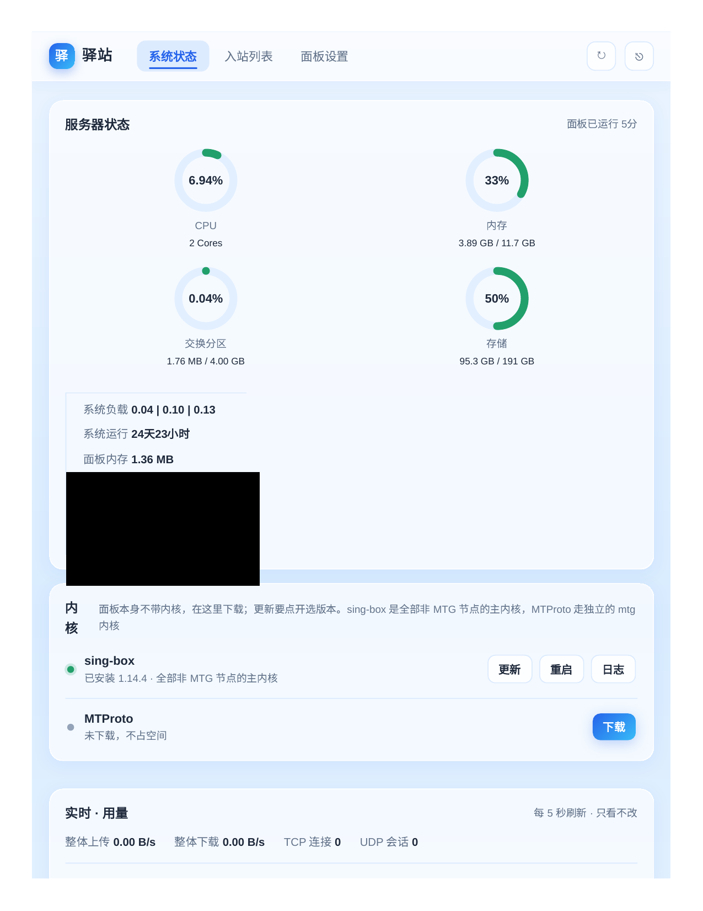
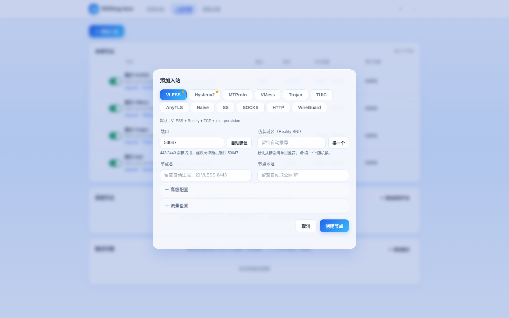
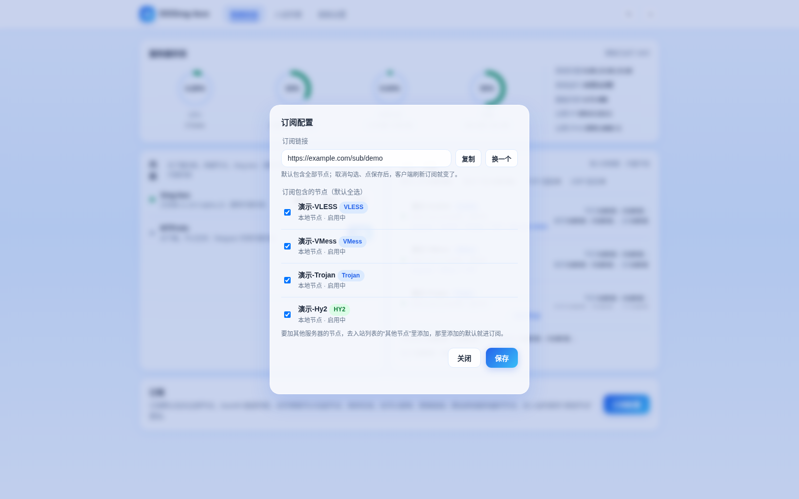

# SSSing-box

单页面代理面板：一个页面管全部节点，基于 sing-box 内核，支持 12 种协议。

## 一键安装

```bash
curl -fsSL https://raw.githubusercontent.com/pal537/SSSing-box/main/install.sh | bash
```

装完直接打印面板地址、账号、密码（自动生成，不用打开初始化页面）。也可以自定义：

```bash
SSSINGBOX_USER=admin SSSINGBOX_PASS=xxxx SSSINGBOX_PORT=18081 bash install.sh
```





## 支持的协议

VLESS、Hysteria2、MTProto、VMess、Shadowsocks、SOCKS5、HTTP、Trojan、WireGuard、TUIC、AnyTLS、Naive（含 Reality / WS / H2 / HTTPUpgrade / CF 等搭建方式）。

## 不用面板：SSH 命令行管理

```bash
sssingbox menu          # 交互菜单：选协议、填参数，自动建节点
sssingbox node list     # 节点列表
sssingbox node add -protocol vless -mode reality   # 命令行建节点
sssingbox node rm <id/端口/名字>
sssingbox node on|off <id/端口/名字>
sssingbox status        # 面板状态
sssingbox sub           # 订阅链接
sssingbox admin reset   # 重置管理员密码
```

装完就能用 `sssingbox` 命令（安装器已写好 CLI 凭证）；面板里改过账号或密码后跑 `sssingbox login` 重新保存。

## 卸载

```bash
bash install.sh uninstall   # 数据目录保留，彻底删除：rm -rf /var/lib/sssingbox
```

## 自己编译

```bash
go build -o sssingbox .
./sssingbox -data /var/lib/sssingbox -port 18081
```

